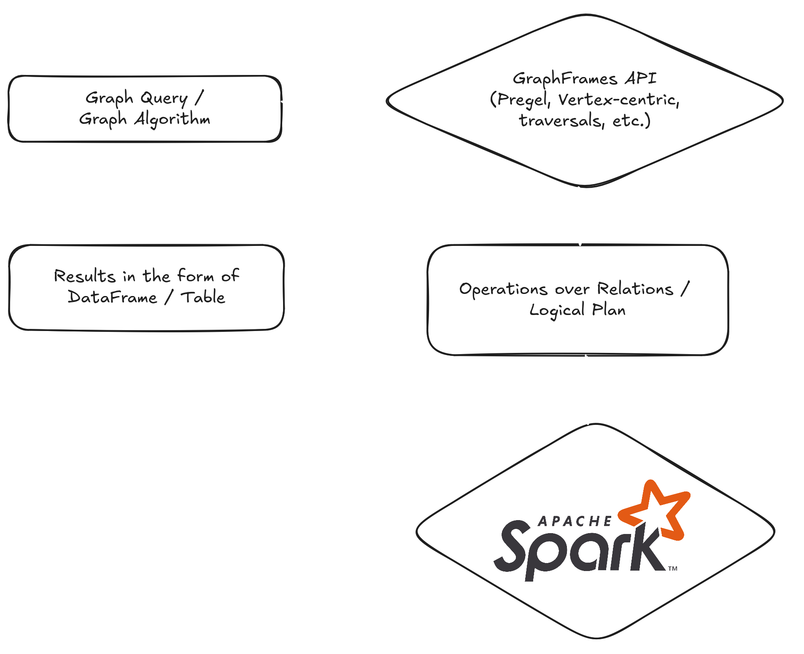
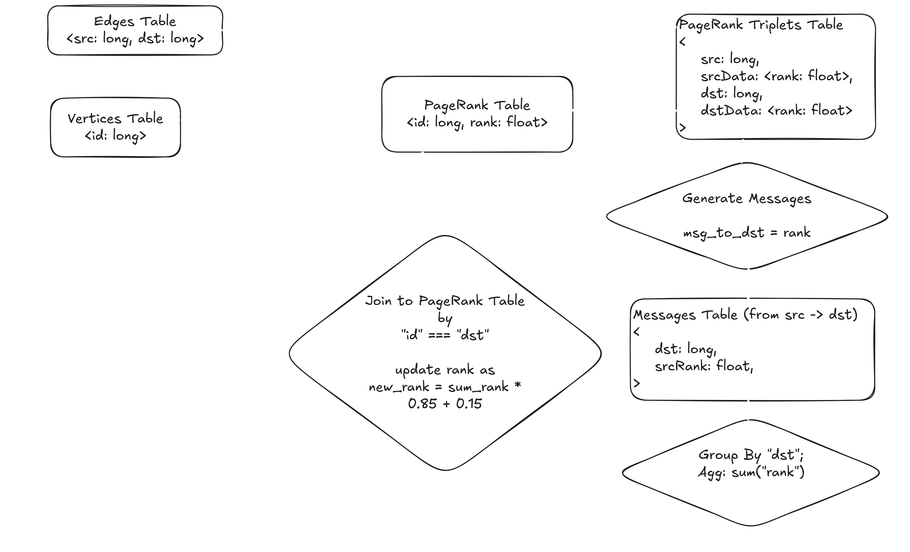

To learn how GraphFrames works internally to combine graph and relational queries, check out the paper [GraphFrames: An Integrated API for Mixing Graph and Relational Queries, Dave et al. 2016](https://people.eecs.berkeley.edu/~matei/papers/2016/grades_graphframes.pdf).

## Overview

GraphFrames gives users an API and abstractions for working with graphs, pattern matching, and running algorithms. Under the hood, all these operations are translated into standard relational operations – select, join, group by, aggregate – over DataFrames. DataFrames are just data in tabular form. The translated logical plan runs on an Apache Spark cluster. The user always gets results back as a DataFrame, which is simply a table.

## Graph Representation

The main abstraction is the [GraphFrame](api/scala/org/apache/spark/graphframes/GraphFrame.html) class that contains two `DataFrame` objects: one for the graph vertices and one for the graph edges. Any operation on the graph is performed on these two `DataFrame`s by combining operations like `filter`, `join`, `select`, etc. The simplest example of such an operation is `inDegrees` which returns the in-degree of each vertex by simply grouping edges by the source vertex and counting the number of rows in each group.

## Vertex-centric Algorithms

Let’s look at a concrete example – PageRank. This algorithm became famous for powering Google Search (fun fact: “Page” is actually the last name of Google co-founder Larry Page, not just about web pages). PageRank helps find the most “important” nodes in a graph, like ranking web pages by relevance.

In GraphFrames, many algorithms are built on the Pregel framework ([*Malewicz, Grzegorz, et al. "Pregel: a system for large-scale graph processing." Proceedings of the 2010 ACM SIGMOD International Conference on Management of data. 2010.*](https://15799.courses.cs.cmu.edu/fall2013/static/papers/p135-malewicz.pdf)). Some algorithms, such as PageRank, currently rely on GraphX-backed implementations. We represent the graph as two `DataFrames`, which you can think of as tables: one for edges and one for vertices. The PageRank table is initialized by assigning every vertex a starting rank of `1.0`.

Each iteration of PageRank works like a series of SQL operations. The process starts by joining the edges table with the current PageRank values for each vertex. This creates a triplets table, where each row contains a source, destination, and their current ranks. Next, we generate messages: each source sends its rank to its destination. These messages are grouped by destination and summed up. Finally, we join the results back to the PageRank table and update the rank using a simple formula: `new_rank = sum_rank * 0.85 + 0.15`, where `0.85` is the damping factor and `0.15` is the reset probability (alpha) that vertices with no in-links converge to.

This whole process is repeated – each step is just a combination of joins, group by, and aggregates over tables – until the ranks stop changing much. The algorithm converges quickly, usually in about 15–20 iterations. Since it relies entirely on SQL operations, running PageRank on an Apache Spark cluster gives you excellent horizontal scalability. As long as your tables fit in Spark, you can compute PageRank using Pregel. In practice, this means you can almost infinitely scale just by adding more hardware.