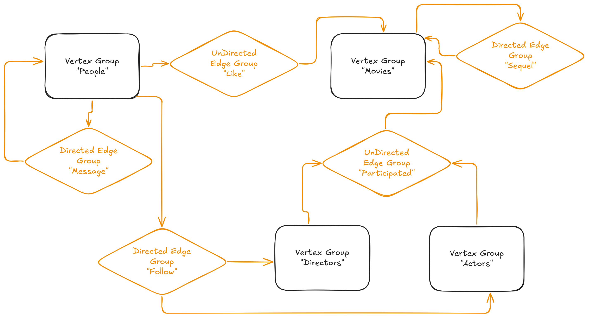

## Overview

From the [Wikipedia](https://en.wikipedia.org/wiki/Property_graph), a property graph, labeled property graph, or attributed graph is a data model, where pairs of entities are associated by relationships, and entities and relationships can have properties.



To make this concrete, let's imagine an example of the “movie fan social network.” The diagram above shows how this looks as a property graph. There are people and movies – two types of vertices, each with their own properties. People can like movies (undirected edges), send messages to each other (directed edges), and follow directors. There are also actors and directors as separate vertex types. Movies can be connected as sequels. All these relationships and entities are easy to represent in a property graph, as shown in the diagram.

The property graph model is very universal. Take a banking payments network: there are legal entities, government services, individuals, exchanges, and goods. Each is a different vertex type. Payments are directed, weighted edges with properties like date and amount. Two legal entities sharing a board member form an undirected, unweighted edge with the director’s details as properties. This structure is great for compliance, KYC, and anti-fraud. It helps to see who is connected to whom and how closely.

Or consider an online marketplace. There are buyers, sellers, and products. Buyers purchase products from sellers. Sellers offer many products. All of this fits naturally into a property graph. This structure works well for recommendation systems. Recommending a product is basically a link prediction problem in the graph.

Another example is Organizational Network Analysis (ONA). Companies have departments, teams, and people, all connected in different ways. Teams assign tasks to each other. People have both formal and informal relationships. There are official and real hierarchies. ONA can reveal key employees, process bottlenecks, and even predict conflicts. It also helps improve knowledge sharing across the organization.

## Property Graphs in GraphFrames

GraphFrames represent a property graph as a combination of multiple logical structures named **Vertex Property Group** linked by multiple logical structures named **Edge Property Group**.

### Vertex Property Group

For API details see [VertexPropertyGroup](api/scala/org/apache/spark/graphframes/propertygraph/property/VertexPropertyGroup.html) (Scala) or `pyspark.graphframes.pg.VertexPropertyGroup` (Python). It contains a name of the property group, for example, `movies`, a name of ID column and underlying data in the form of a `DataFrame`.

The simple example below creates two property groups: `people` and `movies`.

<div class="codetabs">

<div data-lang="python" markdown="1">

```python
from pyspark.graphframes.pg import VertexPropertyGroup

people_data = spark.createDataFrame(
    [(1, "Alice"), (2, "Bob"), (3, "Charlie"), (4, "David"), (5, "Eve")],
    ["id", "name"]
)
people_group = VertexPropertyGroup("people", people_data, "id")

movies_data = spark.createDataFrame(
    [(1, "Matrix"), (2, "Inception"), (3, "Interstellar")],
    ["id", "title"]
)
movies_group = VertexPropertyGroup("movies", movies_data, "id")
```
</div>

<div data-lang="scala" markdown="1">

```scala
import org.apache.spark.graphframes.propertygraph.property.VertexPropertyGroup

val peopleData = spark
  .createDataFrame(
    Seq((1L, "Alice"), (2L, "Bob"), (3L, "Charlie"), (4L, "David"), (5L, "Eve")))
  .toDF("id", "name")

val peopleGroup = VertexPropertyGroup("people", peopleData, "id")

val moviesData = spark
  .createDataFrame(Seq((1L, "Matrix"), (2L, "Inception"), (3L, "Interstellar")))
  .toDF("id", "title")

val moviesGroup = VertexPropertyGroup("movies", moviesData, "id")
```
</div>

</div>

### Edge Property Group

For API details see [EdgePropertyGroup](api/scala/org/apache/spark/graphframes/propertygraph/property/EdgePropertyGroup.html) (Scala) or `pyspark.graphframes.pg.EdgePropertyGroup` (Python). It contains a name of the property group, links to the source and target vertex property groups, direction of the edges (`directed` or `undirected`), and underlying data in the form of a `DataFrame`. Optionally, it can contain a column with edge weights as well as names of source and target vertex ID columns.

The simple example below creates an edge property group with the name `likes` and links to the `people` and `movies` vertex property groups as well as `messages` property group that links people to people.

<div class="codetabs">

<div data-lang="python" markdown="1">

```python
from pyspark.sql.functions import col, lit
from pyspark.graphframes.pg import EdgePropertyGroup

likes_data = spark.createDataFrame(
    [(1, 1), (1, 2), (2, 1), (3, 2), (4, 3), (5, 2)],
    ["src", "dst"]
).withColumn("weight", lit(1.0))

likes_group = EdgePropertyGroup(
    "likes",
    likes_data,
    people_group,
    movies_group,
    is_directed=False,
    src_column_name="src",
    dst_column_name="dst",
    weight_column_name="weight"
)

messages_data = spark.createDataFrame(
    [(1, 2, 5.0), (2, 3, 8.0), (3, 4, 3.0), (4, 5, 6.0), (5, 1, 9.0)],
    ["src", "dst", "weight"]
)

messages_group = EdgePropertyGroup(
    "messages",
    messages_data,
    people_group,
    people_group,
    is_directed=True,
    src_column_name="src",
    dst_column_name="dst",
    weight_column_name="weight"
)
```
</div>

<div data-lang="scala" markdown="1">

```scala
import org.apache.spark.graphframes.propertygraph.property.EdgePropertyGroup

val likesData = spark
  .createDataFrame(Seq((1L, 1L), (1L, 2L), (2L, 1L), (3L, 2L), (4L, 3L), (5L, 2L)))
  .toDF("src", "dst")

val likesGroup = EdgePropertyGroup(
  "likes",
  likesData,
  peopleGroup,
  moviesGroup,
  isDirected = false,
  "src",
  "dst",
  lit(1.0))

val messagesData = spark
  .createDataFrame(
    Seq((1L, 2L, 5.0), (2L, 3L, 8.0), (3L, 4L, 3.0), (4L, 5L, 6.0), (5L, 1L, 9.0)))
  .toDF("src", "dst", "weight")

val messagesGroup = EdgePropertyGroup(
  "messages",
  messagesData,
  peopleGroup,
  peopleGroup,
  isDirected = true,
  "src",
  "dst",
  col("weight"))
```
</div>

</div>

### Property GraphFrame

Having defined the property groups, we can create a `PropertyGraphFrame` by passing the property groups to the constructor.

<div class="codetabs">

<div data-lang="python" markdown="1">

```python
from pyspark.graphframes.pg import PropertyGraphFrame

people_movies_graph = PropertyGraphFrame(
    [people_group, movies_group],
    [likes_group, messages_group]
)
```
</div>

<div data-lang="scala" markdown="1">

```scala
import org.apache.spark.graphframes.propertygraph.PropertyGraphFrame

peopleMoviesGraph =
  PropertyGraphFrame(Seq(peopleGroup, moviesGroup), Seq(likesGroup, messagesGroup))
```
</div>

</div>

### Conversion to GraphFrames

The `PropertyGraphFrame` can be converted to a `GraphFrame` by calling `toGraphFrame` (Scala) or `to_graphframe` (Python). Users can select a subset of vertex and edge property groups to be included in the resulting `GraphFrame`. Under the hood, the conversion will take care about handling potential vertex and edge ID collisions by applying hashing to both vertex and edge IDs.

<div class="codetabs">

<div data-lang="python" markdown="1">

```python
from pyspark.sql.functions import lit

graph = people_movies_graph.to_graphframe(
    vertex_property_groups=["people"],
    edge_property_groups=["messages"],
    edge_group_filters={"messages": lit(True)},
    vertex_group_filters={"people": lit(True)}
)
```
</div>

<div data-lang="scala" markdown="1">

```scala
val graph = peopleMoviesGraph.toGraphFrame(
  Seq("people"),
  Seq("messages"),
  Map("messages" -> lit(true)),
  Map("people" -> lit(true)))
```
</div>

</div>

For more details see [PropertyGraphFrame](api/scala/org/apache/spark/graphframes/propertygraph/PropertyGraphFrame.html) (Scala) or [PropertyGraphFrame](api/python/reference/api/pyspark.graphframes.pg.PropertyGraphFrame.html) (Python).

This operation is not free, so user can also explicitly specify for each of `VertexGroup` does it need to be hashed or not.

<div class="codetabs">

<div data-lang="python" markdown="1">

```python
movies_data = spark.createDataFrame(
    [(1, "Matrix"), (2, "Inception"), (3, "Interstellar")],
    ["id", "title"]
)
movies_group = VertexPropertyGroup(
    "movies", movies_data, "id", apply_mask_on_id=False
)
```
</div>

<div data-lang="scala" markdown="1">

```scala
val moviesData = spark
  .createDataFrame(Seq((1L, "Matrix"), (2L, "Inception"), (3L, "Interstellar")))
  .toDF("id", "title")

val moviesGroup = VertexPropertyGroup("movies", moviesData, "id", applyMaskOnId = false)
```
</div>

</div>

### Projection

The `PropertyGraphFrame` support projection of edges groups to a new edge group. For example, if we have a property graph, where people can like movies, we can do a projection of such a bi-graph to a graph of only peoples where two people are connected if they like the same movie. This operation creates a new `PropertyGraphFrame` with a new edge group and without the original edge group through which the projection was done.

<div class="codetabs">

<div data-lang="python" markdown="1">

```python
projected_graph = people_movies_graph.projection_by("people", "movies", "likes")
```
</div>

<div data-lang="scala" markdown="1">

```scala
val projectedGraph = peopleMoviesGraph.projectionBy("people", "movies", "likes")
```
</div>

</div>

### Joining Algorithm Results

After running graph algorithms on a `GraphFrame` created from a `PropertyGraphFrame`, you can join the results back to the original vertex data using `join_vertices` (Python) or `joinVertices` (Scala).

<div class="codetabs">

<div data-lang="python" markdown="1">

```python
components = graph.connectedComponents()
joined_back = people_movies_graph.join_vertices(components, ["people", "movies"])
```
</div>

<div data-lang="scala" markdown="1">

```scala
val components = graph.connectedComponents()
val joinedBack = peopleMoviesGraph.joinVertices(components, Seq("people", "movies"))
```
</div>

</div>
