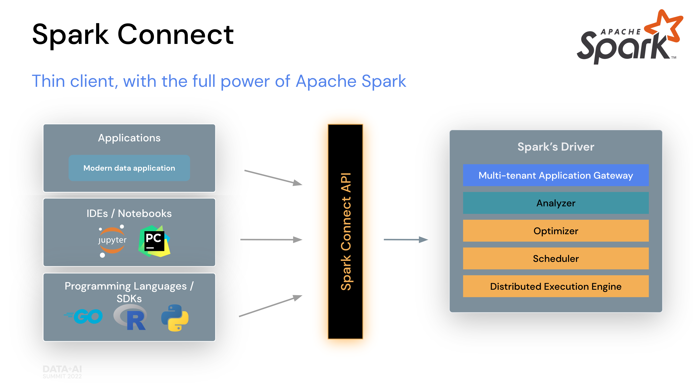
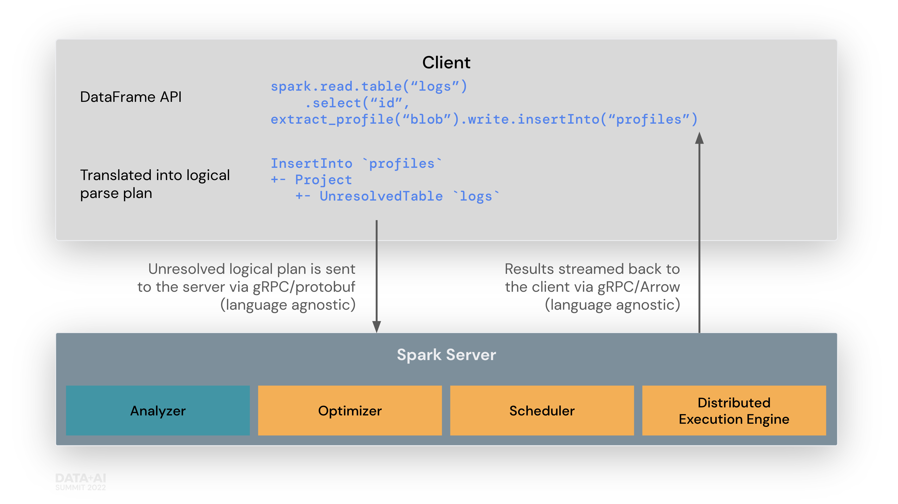

Spark Connect is a decoupled client-server architecture for Apache Spark. A thin client
library speaks to a Spark cluster over gRPC using the DataFrame API and unresolved logical
plans as the protocol, so Spark and its open ecosystem can be used from anywhere:
embedded in modern data applications, in IDEs, in notebooks and in programming languages.
Spark Connect has been part of Apache Spark since the 3.4 release.

To get started, see [Quickstart: Spark Connect](api/python/getting_started/quickstart_connect.html).

* This will become a table of contents (this text will be scraped).
{:toc}

  

# How Spark Connect works

The Spark Connect client library is designed to simplify Spark application
development. It is a thin API that can be embedded everywhere: in application
servers, IDEs, notebooks, and programming languages. The Spark Connect API
builds on Spark's DataFrame API using unresolved logical plans as a
language-agnostic protocol between the client and the Spark driver.

The Spark Connect client translates DataFrame operations into unresolved
logical query plans which are encoded using protocol buffers. These are sent
to the server using the gRPC framework.

The Spark Connect endpoint embedded on the Spark Server receives and
translates unresolved logical plans into Spark's logical plan operators.
This is similar to parsing a SQL query, where attributes and relations are
parsed and an initial parse plan is built. From there, the standard Spark
execution process kicks in, ensuring that Spark Connect leverages all of
Spark's optimizations and enhancements. Results are streamed back to the
client through gRPC as Apache Arrow-encoded row batches.

  

## How Spark Connect client applications differ from classic Spark applications

One of the main design goals of Spark Connect is to enable a full separation and
isolation of the client from the server. As a consequence, there are some changes
that developers need to be aware of when using Spark Connect:

1. The client does not run in the same process as the Spark driver. This means that
   the client cannot directly access and interact with the driver JVM to manipulate
   the execution environment. In particular, in PySpark, the client does not use Py4J
   and thus the accessing the private fields holding the JVM implementation of `DataFrame`,
   `Column`, `SparkSession`, etc. is not possible (e.g. `df._jdf`).
2. By design, the Spark Connect protocol uses Sparks logical
   plans as the abstraction to be able to declaratively describe the operations to be executed
   on the server. Consequently, the Spark Connect protocol does not support all the
   execution APIs of Spark, most importantly RDDs. Alternatives for missing RDD functionality
   are provided as part of the higher-level DataFrame API.
3. Spark Connect provides a session-based client for its consumers. This means that the
   client does not have access to properties of the cluster that manipulate the
   environment for all connected clients. Most importantly, the client cannot change the
   static Spark configuration and has no access to the SparkContext.

Apart from these differences the Spark Connect API is code-compatible with classic Spark
applications: the DataFrame code they contain does not change. What changes is around that code:
how the application is launched and configured, where its dependencies go, and when a plan is
analyzed. The [Spark Connect Programming Guide](spark-connect-programming-guide.html) covers
launching, configuration, dependencies and migration; the
[Eager vs Lazy](spark-connect-gotchas.html) page covers the behavioral differences, starting with
the deferred analysis of query plans.

# Operational benefits of Spark Connect

With this new architecture, Spark Connect mitigates several multi-tenant
operational issues:

**Stability**: Applications that use too much memory will now only impact their
own environment as they can run in their own processes. Dependencies installed on
the client do not conflict with the Spark driver's, although anything a UDF imports
still has to be available on the server.

**Upgradability**: The Spark driver can now seamlessly be upgraded independently
of applications, for example to benefit from performance improvements and security fixes.
This means applications can be forward-compatible, as long as the server-side RPC
definitions are designed to be backwards compatible.

**Remote connectivity**: The decoupled architecture allows remote connectivity to Spark beyond SQL
and JDBC: any application can now interactively use Spark "as a service".

**Simplicity**: The number of APIs exposed to the user is reduced from 3 to 2. The Spark Connect
API is fully declarative and consequently easy to learn for new users familiar with SQL.

**Debuggability and observability**: Spark Connect enables interactive debugging
during development directly from your favorite IDE. Similarly, applications can
be monitored using the application's framework native metrics and logging libraries.

# What is supported

**PySpark**: Spark Connect supports most PySpark APIs, including
[DataFrame](api/python/reference/pyspark.sql/dataframe.html),
[Functions](api/python/reference/pyspark.sql/functions.html), and
[Column](api/python/reference/pyspark.sql/column.html). However,
some APIs such as [SparkContext](api/python/reference/api/pyspark.SparkContext.html)
and [RDD](api/python/reference/api/pyspark.RDD.html) are not supported.
You can check which APIs are currently
supported in the [API reference](api/python/reference/index.html) documentation.
Supported APIs are labeled "Supports Spark Connect" so you can check whether the
APIs you are using are available before migrating existing code to Spark Connect.

**Scala**: Spark Connect supports most Scala APIs, including
[Dataset](api/scala/org/apache/spark/sql/Dataset.html),
[functions](api/scala/org/apache/spark/sql/functions$.html),
[Column](api/scala/org/apache/spark/sql/Column.html),
[Catalog](api/scala/org/apache/spark/sql/catalog/Catalog.html) and
[KeyValueGroupedDataset](api/scala/org/apache/spark/sql/KeyValueGroupedDataset.html).

User-Defined Functions (UDFs) are supported, by default for the shell and in standalone applications with
additional set-up requirements.

Majority of the Streaming API is supported, including
[DataStreamReader](api/scala/org/apache/spark/sql/streaming/DataStreamReader.html),
[DataStreamWriter](api/scala/org/apache/spark/sql/streaming/DataStreamWriter.html),
[StreamingQuery](api/scala/org/apache/spark/sql/streaming/StreamingQuery.html) and
[StreamingQueryListener](api/scala/org/apache/spark/sql/streaming/StreamingQueryListener.html).

APIs such as [SparkContext](api/scala/org/apache/spark/SparkContext.html)
and [RDD](api/scala/org/apache/spark/rdd/RDD.html) are unsupported in Spark Connect.

**Other clients**: Because the protocol is language-agnostic, Spark Connect clients exist
outside the Apache Spark repository as well. The Apache Software Foundation hosts clients for
[Go](https://github.com/apache/spark-connect-go),
[Rust](https://github.com/apache/spark-connect-rust) and
[Swift](https://github.com/apache/spark-connect-swift), each released on its own schedule.

# Where to go from here

* [Spark Connect Programming Guide](spark-connect-programming-guide.html): connect from Python,
  Scala and Rust, run and configure jobs, ship code to the server, and migrate code that uses
  `SparkContext` or RDDs.
* [Setting up Spark Connect](spark-connect-setup.html): start a Spark Connect server, connect
  to it from the shells and from standalone applications, run a persistent local server for
  development, switch existing applications between Spark Classic and Spark Connect, and put
  the server behind an authenticating proxy.
* [Eager vs Lazy: Spark Connect vs Spark Classic](spark-connect-gotchas.html): how deferred
  analysis changes the behavior of temporary views, UDFs and error reporting, how a session
  differs from a local one, and how to write code that works in both modes.
* [Extending Spark with Spark Server Libraries](spark-connect-server-libs.html): add custom
  server-side logic and expose it to clients through the Spark Connect protocol.
* [Quickstart: Spark Connect](api/python/getting_started/quickstart_connect.html): a notebook
  walkthrough for PySpark.
